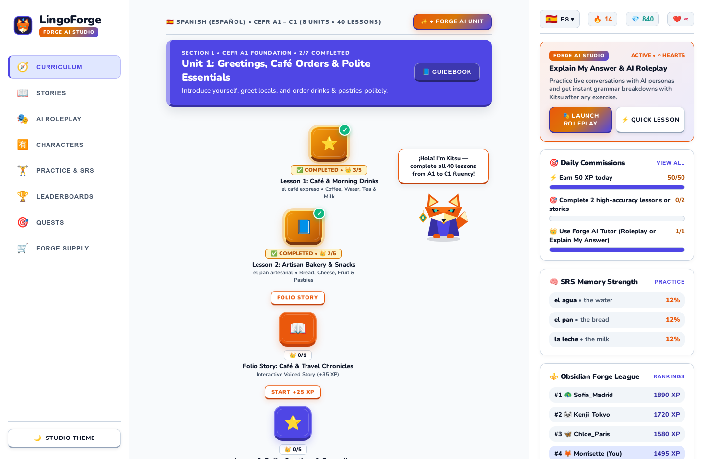

# LingoForge — Polyglot Language Atelier & Forge AI Roleplay Studio

LingoForge is an independent, self-hosted language-learning web application and CLI featuring **Kitsu** (the origami fox & forge-lantern companion), built with Flask, SQLite, Half-Life Regression spaced repetition (SRS), Levenshtein typo-tolerant answer grading, neural text-to-speech (`edge-tts` with Web Speech API fallback), and **Forge AI Studio** tutoring/roleplay (`google-genai` with deterministic offline fallbacks).



## Features

- **10 Languages with 8 CEFR A1–C1 Units & 40 Unique Lessons per Language (400 Lessons Total)** (`curriculum_data.py`, `curriculum_expansion.py`): Spanish (`es`), French (`fr`), Japanese (`ja`), German (`de`), Italian (`it`), Korean (`ko`), Mandarin Chinese (`zh`), Portuguese (`pt`), Russian (`ru`), and Arabic (`ar`). Every language spans Beginner (`A1`) through Fluent Mastery (`C1`) with 40 distinct lessons—each with its own target vocabulary, native sentences, grammar tips, and unit guidebooks.
- **8 Interactive Exercise Mechanics & Party Celebration**: Multiple-choice translation, word-bank tile assembly, listening comprehension (normal & slow neural audio), free-type translation with accent bars, tap-pair matching, fill-in-the-blank cloze, image-card selection, and speaking pronunciation checks. Completing any lesson triggers a confetti party celebration, awards XP/gems/crowns, highlights the completed tile in **Mastered Gold (`✓`)** on the curriculum map, and advances the `START +XP` badge to the next uncompleted lesson.
- **Half-Life Regression Spaced Repetition (SRS) & Levenshtein Grader** (`lingo_engine.py`): Tracks per-word memory strength $p = 2^{-\Delta t / h}$, updates half-life $h$ on every review, schedules weak-word restoration sessions, and distinguishes 1-edit typos from conceptual mistakes (logging errors to a Mistakes Inbox).
- **Forge AI Studio ("Explain My Answer", Live Roleplay Missions & Custom Unit Builder)**: Contextual grammar breakdowns, multi-turn conversational roleplay scenarios (e.g., *The Artisanal Café*, *Central Express Rail Desk*) with CEFR coaching tips, and on-demand custom unit generation—powered by Gemini (`GEMINI_API_KEY`) when configured, with deterministic local fallbacks when offline.
- **Interactive Voiced Stories & Non-Latin Character Trainers**: Multi-line dialogue stories with inline comprehension checks, plus dedicated character/script trainers (Japanese Hiragana & Katakana, Korean Hangul, Russian Cyrillic, Arabic Abjad, Mandarin Pinyin tones, and Romance/Germanic diacritics).
- **1:1 CLI Parity (`cli.py`)**: Inspect state, switch languages, run answer explanations, and practice weak SRS words directly from the terminal.

## Requirements

- Python 3.9+ (`Flask`, `edge-tts`, `google-genai`)
- Optional: `GEMINI_API_KEY` environment variable for live LLM generation (falls back to built-in deterministic responses when unset)

## Quick Start

```bash
./run.sh
```

Then open `http://127.0.0.1:8103` in your browser. On first launch, `LingoForgeEngine` automatically initializes `data/lingoforge.db` and `data/tts/`.

## Running Tests & CLI

```bash
python3 -m unittest discover -s tests
python3 cli.py state
python3 cli.py switch-lang ja
```

## Project Layout

```text
server.py              Flask server (/api/state, /api/dispatch, /api/explain_answer, /api/roleplay, /api/generate_unit, /api/tts)
lingo_engine.py        SQLite persistence, Half-Life Regression SRS, Levenshtein grader, and AI/offline tutor engine
curriculum_data.py     10-language curriculum, exercise generators, stories, roleplay scenarios, and character tables
cli.py                 Command-line interface with 1:1 engine parity
templates/index.html   Single-page application UI (Learn, Stories, Roleplay, Characters, Practice/SRS, Leaderboards, Quests, Shop)
static/fonts/          Bundled Nunito WOFF2 font weights (400–900)
tests/test_engine.py   Unit tests for engine lifecycle, SRS, grading, and offline AI fallbacks
```

## Licence

MIT; see [LICENSE](LICENSE). Bundled third-party assets remain under their own licences (see [THIRD_PARTY_NOTICES.md](THIRD_PARTY_NOTICES.md)).
